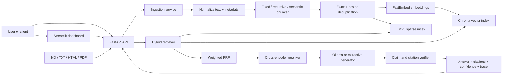

# Hybrid Docs RAG: Complete Interview Preparation Guide

This is the beginner-first guide to the entire project. Read it in order the first time. It starts with definitions, then explains the architecture, every important file, every major design decision, how the project was built, how to run it, how to demonstrate it, and how to answer interview questions honestly.

This project is publicly available at <https://github.com/prospeck/hybrid-docs-rag>.

## 1. What You Built, in Plain English

You built a system that lets a user ask questions about a private collection of company documents.

Instead of asking a language model to answer from its general training data, the system first searches the company's documents, finds the passages most likely to contain the answer, and gives only those passages to the language model. The answer includes numbered citations such as `[1]` and `[2]`, and the system checks whether those citations actually support the claims.

The project is stronger than a basic "chat with a PDF" demo because it includes:

- Four input formats: Markdown, plain text, HTML, and PDF.
- Three switchable chunking strategies.
- Dense semantic search and sparse BM25 keyword search.
- Weighted Reciprocal Rank Fusion to combine both search methods.
- A cross-encoder reranker for a more precise second pass.
- Near-duplicate detection.
- Grounded answer generation and graceful refusal.
- Claim-level citation verification.
- Explainable confidence scores.
- A 56-question evaluation dataset.
- Dense-only versus hybrid and chunking-strategy comparisons.
- A FastAPI API, Streamlit dashboard, Docker Compose stack, automated tests, and GitHub Actions CI.
- A free, local default stack with no paid API key required.

### The one-sentence version

> I built a production-oriented RAG system that ingests multi-format internal documentation, synchronizes dense Chroma and sparse BM25 indexes, combines retrieval with weighted RRF, reranks candidates with a cross-encoder, and produces grounded, citation-verified answers with confidence scores.

### The 30-second interview pitch

> Most RAG demos depend only on vector similarity and return an answer without proving that its citations are valid. I built a hybrid retrieval pipeline for internal documentation. It normalizes Markdown, text, HTML, and PDF files; supports fixed, recursive, and semantic chunking; and stores the same chunks in Chroma and BM25. At query time, it combines dense and sparse rankings using weighted Reciprocal Rank Fusion, reranks the top candidates with a cross-encoder, then generates an answer using only the retrieved context. I added claim-level citation verification, a structured insufficient-context response, confidence scoring, a 56-case evaluation suite, FastAPI, Streamlit, Docker, and CI. The whole default stack runs locally without a paid key.

## 2. Essential Definitions Before the Architecture

Do not memorize these word for word. Understand the idea and explain it simply.

### Artificial Intelligence, Machine Learning, and Language Models

**Artificial Intelligence (AI)** is the broad field of building computer systems that perform tasks associated with human intelligence, such as understanding language, recognizing images, planning, or making predictions.

**Machine Learning (ML)** is a subset of AI in which a model learns patterns from data instead of being programmed with a rule for every possible input.

**Large Language Model (LLM)** is a neural network trained on large amounts of text to predict and generate language. An LLM can explain, summarize, and answer questions, but it does not automatically know a company's current private documents.

**Token** is a small unit of text processed by a language model. A token can be a whole word, part of a word, punctuation, or whitespace. Models have a maximum **context window**, measured in tokens.

**Context window** is the maximum amount of input and generated output a model can handle in one request. RAG must select only the most useful document chunks because an entire document collection will not fit into this window.

**Hallucination** is an answer or claim generated without adequate evidence. The language may sound confident even when the content is false. This project reduces hallucination through retrieval, grounding instructions, citation verification, and refusal thresholds.

### RAG and Grounding

**Retrieval-Augmented Generation (RAG)** is an architecture with two major stages:

1. Retrieve relevant information from an external knowledge source.
2. Give that information to a generator so it can answer using the retrieved evidence.

RAG does not retrain the LLM. It supplies current or private knowledge at request time.

**Grounding** means requiring the answer to be based on provided evidence rather than unsupported model knowledge. A grounded answer should be traceable to source passages.

**Corpus** is the complete collection of documents indexed by the system.

**Ingestion** is the process of reading a source document, cleaning it, splitting it into chunks, embedding those chunks, and updating search indexes.

**Index** is a data structure optimized for search. This project maintains a dense vector index in Chroma and a sparse keyword index using BM25.

### Documents, Chunks, and Metadata

**Normalization** converts different input formats into a consistent clean-text representation. HTML tags, PDF pages, Markdown headings, and plain text are handled differently during loading but become a common internal `Document` model.

**Chunk** is a smaller passage cut from a document. Retrieval operates on chunks rather than entire files because smaller passages are more focused and fit into the model context.

**Chunk size** controls how much text is placed in one chunk. Large chunks carry more context but can contain unrelated material. Small chunks are precise but may separate facts that belong together.

**Chunk overlap** repeats some text between adjacent chunks. This reduces the chance that an important sentence is cut at a chunk boundary, but too much overlap increases storage and duplication.

**Metadata** is structured information stored with a chunk, such as source filename, chunk index, section heading, page number, chunking strategy, character count, and document ID. Metadata makes citations and filtering possible.

**Content hash** is a deterministic fingerprint of text. Equal normalized content produces the same hash. It supports idempotency and exact-duplicate detection.

**Idempotency** means repeating the same operation has the same final effect as running it once. Re-ingesting an unchanged document should not create extra copies of its chunks.

### Embeddings and Dense Search

**Embedding** is a list of numbers, also called a vector, that represents the meaning of text. Texts with similar meanings should have vectors located near one another.

Example: "How do I reverse a release?" and "What is the rollback procedure?" use different words but should have similar embeddings.

**Embedding model** is the model that converts text into vectors. The local default is `BAAI/bge-small-en-v1.5` through FastEmbed. It produces 384-dimensional vectors.

**Dimension** is one position in an embedding vector. A 384-dimensional embedding contains 384 numeric values. Individual dimensions are not normally interpreted as human-readable features.

**Dense retrieval** searches by vector similarity. It is called dense because most dimensions contain non-zero values. It is good at semantic similarity, paraphrases, and concept matching.

**Cosine similarity** measures the angle between two vectors:

```text
cosine_similarity(A, B) = (A dot B) / (length(A) * length(B))
```

A higher value usually means greater semantic similarity. This project also uses cosine similarity during near-duplicate detection.

**Vector database** stores embeddings and efficiently finds nearby vectors. This project uses Chroma. Embedded Chroma is convenient for local Python use; Docker Compose uses Chroma in client/server mode.

**Top-k** means return the best `k` results. The default dense search retrieves 10 candidates.

### Sparse Search and BM25

**Sparse retrieval** represents documents using word/token occurrence rather than a dense semantic vector. Most possible vocabulary positions are zero, which is why it is called sparse.

**BM25** stands for Best Matching 25. It is a classic ranking function that rewards query terms appearing in a chunk, gives rare terms more importance, and normalizes for document length.

BM25 is especially useful for exact identifiers such as:

- `OBS-1042`
- `MAX_RETRY_COUNT`
- Function names.
- Error codes.
- Product names and acronyms.

**Term frequency (TF)** is how frequently a term occurs in a document or chunk.

**Inverse document frequency (IDF)** gives more importance to terms that appear in fewer documents. A rare error code usually carries more search information than a common word like "service."

**Tokenization** converts text into searchable pieces. The local tokenizer lowercases and extracts useful alphanumeric terms before BM25 indexing and several evaluation checks.

### Hybrid Search, Rank Fusion, and Reranking

**Hybrid search** uses more than one retrieval method. Here it combines semantic dense retrieval with exact-term sparse BM25 retrieval.

The reason is simple:

- Dense search understands meaning but can miss exact identifiers.
- BM25 matches identifiers well but can miss paraphrases.
- Combining them gives complementary evidence.

**Rank** is a result's position in a sorted list: rank 1 is best, rank 2 is second, and so on.

**Reciprocal Rank Fusion (RRF)** combines ranked result lists without assuming their raw scores are comparable. For a result at rank `r`, a retrieval system contributes:

```text
weight / (rrf_k + rank)
```

This project uses:

```text
RRF(chunk) = 0.7 / (60 + dense_rank) + 0.3 / (60 + sparse_rank)
```

If a chunk does not appear in one result list, it receives no contribution from that list. The merged scores are normalized for display.

**Why not add raw cosine and BM25 scores?** Their scales have different meanings and can change with the corpus or query. Rank is more stable across retrieval systems.

**Candidate generation** is the first broad retrieval stage. Its goal is recall: do not miss potentially useful chunks.

**Reranking** is a second, more expensive relevance stage. Its goal is precision: put the most directly useful candidates at the top.

**Cross-encoder** is a model that reads the question and candidate text together and outputs one relevance score. It is more precise than independently embedding the question and chunk, but too expensive to run against every chunk. This project reranks the fused top 20 and keeps the top 5.

### Generation, Citations, and Confidence

**Prompt** is the instruction and context passed to a language model.

**System prompt** is a high-priority instruction defining the model's behavior. This project tells the generator to use only the supplied evidence, cite numbered context blocks, ignore instructions found inside documents, and say when evidence is insufficient.

**Inline citation** is a reference placed beside a claim, such as `[1]`. The number maps to a retrieved context block and its source metadata.

**Citation verification** checks whether the cited chunk actually supports the nearby claim. A citation is not automatically correct merely because the model printed a bracketed number.

**Claim** is a factual statement that can be checked against evidence. The verifier parses answer sentences and their bracketed references.

**LLM-as-judge** means using a language model to evaluate an output, such as relevance, correctness, or claim support. It is useful but not perfect: it can be inconsistent, costly, or biased. This project has a deterministic local fallback when a provider is unavailable.

**Retrieval confidence** estimates the strength of the final retrieved chunks, weighting higher-ranked hits more heavily.

**Citation coverage** is the proportion of parsed answer claims that have at least one verified citation.

**Completeness** estimates whether important terms or parts of the question appear to be addressed by the answer.

The answered-case composite score is:

```text
composite = 0.45 * retrieval
          + 0.35 * citation_coverage
          + 0.20 * completeness
```

This is a transparent product heuristic, not a mathematically calibrated probability that the answer is correct.

**Graceful refusal** means returning a useful insufficient-context response instead of inventing an answer. By default, the retrieval-confidence threshold is `0.25`.

### APIs, Containers, Tests, and CI

**API** is an interface that lets software communicate with software. The FastAPI server accepts HTTP requests and returns JSON.

**Endpoint** is a particular API method and path, such as `POST /v1/ask`.

**JSON** is a text format for structured data using objects, arrays, strings, numbers, and booleans.

**Schema validation** checks whether input and output match expected types and constraints. FastAPI uses Pydantic models in this project.

**Asynchronous API** can serve other requests while waiting for I/O. Because local embedding, retrieval, and generation libraries expose blocking interfaces, the API offloads them to worker threads with AnyIO.

**Container** packages an application with its runtime and dependencies. Docker makes the environment reproducible.

**Docker image** is an immutable build template. A **container** is a running instance of an image.

**Docker Compose** describes multiple cooperating services. This project runs Chroma, API, dashboard, and Ollama services plus an optional seed job.

**Volume** is persistent Docker-managed storage. It preserves indexes, models, and data when a container is recreated.

**Unit test** checks a small piece of behavior in isolation. **Integration test** checks components working together. This repository contains both styles.

**Code coverage** measures which executable lines are run by tests. It is not proof that every behavior is correct, but it reveals untested paths. The CI requirement is at least 80%.

**Continuous Integration (CI)** automatically runs quality checks after pushes and pull requests. GitHub Actions runs linting, formatting checks, strict type checking, tests, coverage enforcement, and Docker Compose validation.

## 3. The Problem and the Product Requirements

The business problem is that company knowledge is scattered across handbooks, runbooks, API documents, incident procedures, security policies, and architecture pages. Keyword search alone struggles when a user paraphrases the documentation. Semantic search alone can miss exact codes and configuration names. Giving every document to an LLM is slow, expensive, and exceeds the model context window.

The project therefore needed to:

1. Accept several document types.
2. Preserve source metadata for traceability.
3. compare chunking strategies rather than hard-code one guess.
4. retrieve both semantically and lexically.
5. fuse incompatible result types safely.
6. improve precision before generation.
7. make the model answer only from evidence.
8. verify citations after generation.
9. refuse when evidence is weak.
10. expose the result through an API and visual dashboard.
11. measure quality using repeatable evaluations.
12. run without requiring paid credentials.

## 4. System Architecture

### High-level architecture



### The two main pipelines

The system has an offline/write path and an online/read path.

**Ingestion path:**

```text
file -> load -> normalize -> chunk -> embed -> deduplicate
     -> Chroma update -> rebuild BM25 -> persist raw/processed document
```

**Question-answering path:**

```text
question -> query embedding -> dense top 10
         -> BM25 top 10
         -> weighted RRF top 20
         -> cross-encoder top 5
         -> retrieval confidence gate
         -> grounded generation
         -> citation verification
         -> confidence scores and response
```

The separation matters because ingestion can be slower and happens less frequently, while question answering should remain fast and read-only.

## 5. Full Ingestion Flow

### Step 1: Validate the upload

The API accepts only `.md`, `.txt`, `.html`, `.htm`, and `.pdf`. The default size limit is 25 MB. It reads at most the limit plus one byte, rejects oversized files, and reduces the upload name to its basename to prevent directory traversal through a filename.

### Step 2: Load and normalize

`DocumentLoader` selects a loader by extension:

- Markdown and text are decoded and normalized.
- HTML is parsed with Beautiful Soup so visible text and headings can be retained without indexing raw tags.
- PDF text is extracted page by page with pypdf, and page markers allow chunks to carry page numbers.

The original file and normalized representation are stored separately. This supports re-indexing without requiring another upload.

### Step 3: Calculate document identity

The normalized content receives a checksum. It supports deterministic document identity and detects an unchanged re-ingestion.

### Step 4: Apply the selected chunker

The default is recursive structure-aware chunking, but every ingestion can choose `fixed`, `recursive`, or `semantic`. Each output chunk records which strategy produced it.

### Step 5: Generate embeddings

The chunk texts are embedded in a batch. Passage and query embedding paths are kept separate because retrieval models may apply different prefixes or optimizations to documents and questions.

### Step 6: Remove duplicates

The pipeline removes:

- Exact duplicates using normalized content hashes.
- Near-duplicates whose cosine similarity is at least `0.95`.
- Duplicates already in the index.
- Duplicates inside the same new ingestion batch.

This prevents repeated policy text from occupying multiple context slots.

### Step 7: Update the vector store

Accepted chunks and their embeddings are written to Chroma. If this is a new revision of an existing source document, the previous revision is replaced rather than accumulated.

### Step 8: Synchronize BM25

Chroma is treated as the source of truth. After a successful vector update, the BM25 index is rebuilt from the complete current chunk set. The BM25 corpus is persisted as portable JSON, and the in-memory BM25 data structure is reconstructed at startup.

This design avoids the dangerous state where dense search contains version B of a document while sparse search still contains version A.

### Step 9: Roll back on failure

If a failure occurs after the previous version has been removed, the ingestion service restores the old chunks and embeddings and resynchronizes BM25. That gives the operation transaction-like behavior even though the two stores do not share a database transaction.

## 6. The Three Chunking Strategies

### Fixed-size chunking

Fixed chunking cuts text by configured character size with overlap.

Default parameters:

```text
chunk size: 900 characters
overlap:    150 characters
```

Advantages:

- Simple and deterministic.
- Fast.
- Useful as a baseline.

Disadvantages:

- Can cut a paragraph or section at an unnatural point.
- Does not understand document structure or topic changes.

### Recursive structure-aware chunking

The LangChain recursive text splitter attempts progressively smaller separators, favoring boundaries such as headings, paragraphs, lines, and spaces before falling back to character cuts.

Advantages:

- Usually preserves sections and paragraphs better than fixed splitting.
- No additional embedding pass is required for splitting.
- Good general default for technical documentation.

Disadvantages:

- Structure varies between file types.
- A very long section can still be divided.

### Semantic chunking

Semantic chunking examines neighboring units and uses embedding similarity to find topic transitions. A similarity drop beyond the configured percentile creates a boundary.

Advantages:

- Can separate topics even when formatting is weak.
- May group semantically coherent passages.

Disadvantages:

- Requires embeddings during chunk creation, so it is more expensive.
- Results depend on model quality and threshold choice.
- It can create uneven chunks.
- On this small corpus, it did not beat the simpler strategies on every metric.

### Why the strategy is stored in metadata

Storing the strategy makes the index auditable and allows evaluation results to be traced back to the exact preprocessing method. Without this metadata, comparing strategies after ingestion would be unreliable.

## 7. Full Retrieval and Answer Flow

### Step 1: Embed the question

The embedding provider converts the user question into a query vector.

### Step 2: Dense retrieval

Chroma compares the question vector to indexed chunk vectors and returns the top 10 semantic candidates.

### Step 3: Sparse retrieval

BM25 tokenizes the same question and returns the top 10 exact-term candidates.

For `dense` comparison mode, this stage is skipped and the dense weight becomes `1.0`.

### Step 4: Detect index drift

Before a hybrid query, the retriever checks whether BM25's chunk count matches Chroma's. This matters when a separate seed process updated Chroma while the API remained running. If the counts differ, BM25 rebuilds from Chroma automatically.

### Step 5: Weighted RRF

The default weights are 70% dense and 30% sparse, with `rrf_k = 60`. RRF merges duplicate chunk IDs and rewards chunks that rank well in either or both lists.

#### Worked example

Assume chunk A is dense rank 1 and sparse rank 3:

```text
dense contribution  = 0.7 / (60 + 1) = 0.011475
sparse contribution = 0.3 / (60 + 3) = 0.004762
total               = 0.016237
```

Assume chunk B appears only at sparse rank 1:

```text
sparse contribution = 0.3 / (60 + 1) = 0.004918
```

Chunk A wins because both retrievers support it. However, a chunk containing a rare exact error code can still enter through BM25 even if dense retrieval misses it.

### Step 6: Rerank the top 20

The cross-encoder jointly reads `(question, chunk)` pairs and assigns relevance scores. The top five survive. If the model is disabled or unavailable during component construction, the deterministic lexical reranker remains available.

### Step 7: Calculate retrieval confidence

The final hit scores are combined with reciprocal position weights. Rank 1 matters more than rank 5. The output is clamped to `[0, 1]`.

### Step 8: Apply the refusal gate

If confidence is below `0.25`, the generator is not called. The response says it could not find sufficient evidence and suggests the most relevant files to inspect manually.

### Step 9: Build grounded context

The five chunks are formatted as numbered context blocks with source metadata. The prompt tells the model to cite these numbers and not follow instructions found inside retrieved documents.

### Step 10: Generate

The default generator is local Ollama using `llama3.2:3b`. If it cannot be reached or the model has not been pulled, the service uses an explicit extractive fallback and marks the response as degraded.

The fallback is not secretly presented as an LLM answer. The API exposes `provider_used` and `degraded_mode`.

### Step 11: Verify citations

The service parses factual claims and their bracket references. For each valid reference, it compares the claim to the cited evidence. Strong direct lexical matches are verified locally; lower-overlap paraphrases can be sent to a working non-extractive generator for a judge score. If judging fails, the local token-support score is used.

A support score of at least `0.45` marks the citation verified. The response also includes the best supporting quote, source, heading, page, and chunk ID.

### Step 12: Return an explainable response

The result contains:

- Answer text.
- Status: `answered` or `insufficient_context`.
- Citations and verification scores.
- Retrieval, citation coverage, completeness, and composite confidence.
- The final chunks and their dense, sparse, fusion, and rerank trace fields.
- Provider used.
- Degraded-mode flag.
- End-to-end latency.

## 8. Technology Stack and Why Each Choice Was Made

| Layer | Technology | Purpose | Why it was chosen |
|---|---|---|---|
| Language | Python 3.11+ | Entire backend and evaluation stack | Standard AI/ML ecosystem, type hints, strong library support |
| Package manager | uv | Locking, environments, commands | Fast, reproducible installs through `uv.lock` |
| API | FastAPI | HTTP service and OpenAPI | Typed Pydantic models, automatic docs, async-native interface |
| Validation | Pydantic / pydantic-settings | Models and configuration | Runtime type validation and environment-based settings |
| Dense embeddings | FastEmbed + BGE small | Local vector creation | Free quantized ONNX runtime; much smaller container than PyTorch |
| Vector store | Chroma | Store/query embeddings and metadata | Simple embedded mode and client/server Docker mode |
| Sparse retrieval | rank_bm25 | Exact-term retrieval | Small, transparent implementation of BM25 |
| Chunking | langchain-text-splitters | Recursive splitting | Mature configurable separator logic without full LangChain dependency |
| HTML loading | Beautiful Soup | Extract normalized HTML text | Reliable HTML parsing |
| PDF loading | pypdf | Extract text and pages | Lightweight, mature Python PDF reader |
| Reranking | FastEmbed cross-encoder | Second-stage relevance | Free local ONNX model, no paid service |
| Generation | Ollama | Local LLM inference | No paid key, model stays local |
| Fallback generation | Extractive generator | Degraded no-model answer | Keeps the system demonstrable and labels the fallback honestly |
| Dashboard | Streamlit | Visual query/trace interface | Fast Python implementation suitable for a portfolio demo |
| Serialization | orjson / JSON | Fast responses and portable index data | Fast output and no unsafe pickle persistence |
| Testing | pytest, pytest-asyncio, pytest-cov | Automated correctness checks | Standard Python testing tools |
| Linting | Ruff | Style and bug checks | Fast, consolidated linter and formatter |
| Type checking | mypy strict mode | Static correctness | Catches interface and optional-provider errors before runtime |
| Containers | Docker + Compose | Reproducible multi-service runtime | One command brings up API, UI, DB, and LLM server |
| CI | GitHub Actions | Automatic verification | Visible quality signal on every push and pull request |

### Why OpenAI is optional rather than required

The original portfolio specification named OpenAI embeddings and GPT generation, but paid credentials were not available. Provider interfaces were therefore created so the production architecture remains provider-independent while the default path is completely local. OpenAI-compatible adapters can be enabled later without rewriting ingestion, retrieval, or service orchestration.

### Why FastEmbed replaced the heavier default

A Sentence Transformers/PyTorch-first image dramatically increased dependency size and build time. FastEmbed runs quantized ONNX models and preserved real neural embeddings and cross-encoder reranking while producing a practical Docker image. Sentence Transformers remains an optional `torch` extra for experiments.

## 9. Repository Map: Every File and Folder

### Root project and operations files

| File | Responsibility |
|---|---|
| `.dockerignore` | Excludes Git data, caches, local data, tests, and other unnecessary files from the Docker build context. |
| `.env.example` | Documents non-secret environment configuration and optional provider variables. The app does not automatically load it. |
| `.gitignore` | Prevents generated data, caches, virtual environments, credentials, and local artifacts from being committed. |
| `Dockerfile` | Builds the production API image in stages, installs locked runtime dependencies, runs as a non-root user, exposes port 8080, and defines a health check. |
| `docker-compose.yml` | Defines Chroma, API, dashboard, Ollama, the optional seed job, networks through service names, health dependencies, and named volumes. |
| `Makefile` | Short aliases for install, test, lint, typecheck, run, seed, evaluation, and Compose startup. |
| `pyproject.toml` | Defines package metadata, runtime/optional dependencies, CLI entry point, build settings, Ruff, pytest, and strict mypy configuration. |
| `uv.lock` | Pins the exact dependency graph for reproducible installations. It is generated by uv and should be committed. |
| `README.md` | Recruiter-facing overview, architecture summary, quick start, API examples, evaluation commands, settings, and security notes. |
| `INTERVIEW_PREP.md` | This complete beginner-first implementation and interview handbook. |
| `LICENSE` | MIT license for the repository. |
| `eval_dataset.json` | The 56-question golden evaluation dataset, including expected answers, source files, and case categories. |

### GitHub automation

| File | Responsibility |
|---|---|
| `.github/workflows/ci.yml` | Runs install, Ruff lint, formatting check, strict mypy, pytest with 80% coverage threshold, and Compose validation on pushes and PRs. |
| `.github/dependabot.yml` | Configures automated dependency update checks. |

### Application package

| File | Responsibility |
|---|---|
| `src/hybrid_rag/__init__.py` | Package identity and version. |
| `src/hybrid_rag/config.py` | Central typed settings with `RAG_` environment prefix, validation, defaults, and data-directory helpers. |
| `src/hybrid_rag/models.py` | Domain models: documents, chunks, search hits, citations, confidence, answers, ingestion results, and document summaries. |
| `src/hybrid_rag/text.py` | Shared normalization, hashing, tokenization, and numeric clamping utilities. |
| `src/hybrid_rag/loaders.py` | Multi-format loading, metadata extraction, and raw/processed document persistence. |
| `src/hybrid_rag/embeddings.py` | Embedding interface and FastEmbed, hash, optional Sentence Transformers, and optional OpenAI-compatible implementations. |
| `src/hybrid_rag/vector_store.py` | Vector-store interface plus memory and Chroma implementations; add, query, list, count, and delete operations. |
| `src/hybrid_rag/sparse_index.py` | Thread-safe BM25 index, token corpus management, search, and portable JSON persistence. |
| `src/hybrid_rag/ingestion.py` | End-to-end indexing, revision replacement, exact/near deduplication, synchronization, and rollback logic. |
| `src/hybrid_rag/retrieval.py` | Dense and sparse retrieval, weighted RRF, drift detection, cross-encoder or lexical reranking, and retrieval confidence. |
| `src/hybrid_rag/generation.py` | Grounding prompt, context formatting, Ollama/OpenAI/extractive generators, claim parsing, and citation-support checks. |
| `src/hybrid_rag/service.py` | Orchestrates retrieve, refusal, generation, fallback, verification, confidence scoring, and document listing. |
| `src/hybrid_rag/container.py` | Dependency composition: reads settings and wires the selected providers, stores, retriever, ingestion service, and RAG service. |
| `src/hybrid_rag/cli.py` | `hybrid-rag serve`, `seed`, and `evaluate` command implementations. |

### Chunking package

| File | Responsibility |
|---|---|
| `src/hybrid_rag/chunking/__init__.py` | Exposes chunking types and factory functions. |
| `src/hybrid_rag/chunking/strategies.py` | Implements fixed, recursive, and semantic splitting and transfers section/page metadata to chunks. |

### API package

| File | Responsibility |
|---|---|
| `src/hybrid_rag/api/__init__.py` | API package marker. |
| `src/hybrid_rag/api/schemas.py` | Request and response schemas specific to API operations, such as ask, health, and delete payloads. |
| `src/hybrid_rag/api/app.py` | Creates FastAPI, initializes components in the lifespan, adds middleware, and implements all HTTP endpoints. |

### Evaluation package and reports

| File | Responsibility |
|---|---|
| `src/hybrid_rag/evaluation/__init__.py` | Exposes evaluation classes. |
| `src/hybrid_rag/evaluation/runner.py` | Loads golden cases, executes questions, calculates metrics, aggregates categories, and produces a report. |
| `scripts/compare_chunking.py` | Creates isolated temporary indexes, ingests the same corpus under each chunker, evaluates hybrid and dense modes, and writes comparison reports. |
| `eval-results/chunking-comparison.json` | Machine-readable measured comparison results. |
| `eval-results/chunking-comparison.md` | Human-readable comparison table generated from the same results. |

### Dashboard

| File | Responsibility |
|---|---|
| `dashboard/app.py` | Streamlit UI for uploads, document list, questions, retrieval-mode comparison, confidence, citations, and retrieval trace. |
| `dashboard/Dockerfile` | Builds and starts the dashboard container on port 8501. |

### Documentation

| File | Responsibility |
|---|---|
| `docs/ARCHITECTURE.md` | Deeper component design, data flow, consistency boundaries, failure handling, security, and scaling notes. |
| `docs/EVALUATION.md` | Metric definitions, commands, interpretation, and limitations. |
| `docs/CASE_STUDY.md` | Portfolio narrative with problem, architecture choices, measured results, lessons, and next steps. |
| `docs/DEMO_SCRIPT.md` | Timed sub-four-minute walkthrough for recording the portfolio demo. |

### Sample corpus

| File | What it demonstrates |
|---|---|
| `sample_corpus/01-engineering-handbook.md` | Markdown headings and general engineering policy. |
| `sample_corpus/02-incident-response.md` | Incident severity, coordination, and communication procedures. |
| `sample_corpus/03-platform-deployments.md` | Deployment and rollback procedures used by multi-document questions. |
| `sample_corpus/04-api-operations.txt` | Exact identifiers and error codes that demonstrate BM25's value. |
| `sample_corpus/05-security-access.md` | Security and access-management documentation. |
| `sample_corpus/06-system-architecture.html` | HTML ingestion and system architecture content. |

### Data directories

| File/folder | Responsibility |
|---|---|
| `data/raw/.gitkeep` | Keeps the raw-document directory in Git while actual ingested documents remain untracked. |
| `data/processed/.gitkeep` | Keeps the normalized-document directory in Git. |
| `data/indexes/.gitkeep` | Keeps the portable local-index directory in Git. |

### Tests

| File | What it proves |
|---|---|
| `tests/conftest.py` | Builds deterministic test settings and reusable in-memory fixtures. |
| `tests/test_loaders.py` | Verifies supported format loading, metadata, persistence, and loader errors. |
| `tests/test_chunking.py` | Tests all chunking strategies and metadata behavior. |
| `tests/test_indexes.py` | Tests vector search and BM25 persistence/search behavior. |
| `tests/test_retrieval.py` | Tests RRF, dense/hybrid retrieval, ranking, drift synchronization, and confidence. |
| `tests/test_generation.py` | Tests context/prompt formatting, claim parsing, citation support, and extractive generation. |
| `tests/test_ingestion_service.py` | Tests ingestion, duplicates, source revisions, rollback/synchronization, answers, refusals, and citation behavior. |
| `tests/test_api.py` | Exercises health, ingest, ask, list, delete, input validation, headers, and error responses through the HTTP app. |
| `tests/test_evaluation.py` | Tests golden-dataset loading, metric calculation, aggregation, and report structure. |

## 10. Important Data Models

### `Document`

Represents one normalized source file. Important fields include ID, filename, checksum, text, media type, arbitrary metadata, and creation timestamp.

### `Chunk`

Represents one retrievable passage. It stores the parent document ID, source, text, sequential index, strategy, section, page, character count, content hash, and extra metadata.

### `SearchHit`

Wraps a chunk with search diagnostics:

- Current `score` used for sorting.
- Raw dense and sparse scores when available.
- RRF fusion score.
- Cross-encoder rerank score.
- Dense and sparse ranks.

Keeping stage-specific fields makes the dashboard useful for debugging instead of showing only an unexplained final result.

### `Citation`

Maps a numbered answer reference to chunk ID, source, heading, page, supporting quote, verification boolean, and verification score.

### `AnswerResult`

The main API response. It contains the question, answer, citations, confidence dimensions, retrieved chunks, status, provider used, degraded-mode flag, and latency.

## 11. Configuration and Defaults

All application settings use the `RAG_` environment prefix.

| Variable | Default | Meaning |
|---|---:|---|
| `RAG_DATA_DIR` | `data` | Raw, processed, and local-index base directory |
| `RAG_MAX_UPLOAD_MB` | `25` | Maximum upload size |
| `RAG_CHUNK_STRATEGY` | `recursive` | Default fixed, recursive, or semantic chunker |
| `RAG_CHUNK_SIZE` | `900` | Target characters per chunk |
| `RAG_CHUNK_OVERLAP` | `150` | Shared characters between adjacent chunks |
| `RAG_SEMANTIC_BREAKPOINT_PERCENTILE` | `80` | Semantic boundary sensitivity |
| `RAG_EMBEDDING_PROVIDER` | `fastembed` | Local neural, hash test, optional torch, or OpenAI provider |
| `RAG_EMBEDDING_MODEL` | `BAAI/bge-small-en-v1.5` | Default embedding model |
| `RAG_VECTOR_BACKEND` | `chroma` | Chroma or memory vector store |
| `RAG_CHROMA_HOST` | empty | Empty uses embedded Chroma; set host for server mode |
| `RAG_CHROMA_PORT` | `8000` | Chroma server port |
| `RAG_CHROMA_COLLECTION` | `internal_docs` | Chroma collection name |
| `RAG_DENSE_TOP_K` | `10` | Dense candidates |
| `RAG_SPARSE_TOP_K` | `10` | BM25 candidates |
| `RAG_FUSION_TOP_K` | `20` | Candidates retained after RRF |
| `RAG_FINAL_TOP_K` | `5` | Chunks retained after reranking |
| `RAG_DENSE_WEIGHT` | `0.7` | Dense RRF contribution |
| `RAG_SPARSE_WEIGHT` | `0.3` | Sparse RRF contribution |
| `RAG_RRF_K` | `60` | Rank-smoothing constant |
| `RAG_RERANKER_ENABLED` | `true` | Enables local cross-encoder reranking |
| `RAG_RERANKER_MODEL` | `Xenova/ms-marco-MiniLM-L-6-v2` | Default reranker |
| `RAG_MINIMUM_RETRIEVAL_CONFIDENCE` | `0.25` | Refusal threshold |
| `RAG_DUPLICATE_SIMILARITY_THRESHOLD` | `0.95` | Near-duplicate cutoff |
| `RAG_GENERATION_PROVIDER` | `ollama` | Ollama, OpenAI, or extractive |
| `RAG_GENERATION_MODEL` | `llama3.2:3b` | Default local generation model |
| `RAG_OLLAMA_BASE_URL` | `http://localhost:11434` | Ollama server address |
| `RAG_REQUEST_TIMEOUT_SECONDS` | `90` | Provider request timeout |

The settings validator rejects impossible configurations such as zero total retrieval weight or overlap greater than/equal to chunk size.

## 12. API Endpoints

### `GET /health`

Returns service status, indexed chunk count, selected embedding provider, generation provider, and vector backend.

Use it to distinguish "the server is reachable" from "documents are indexed."

### `POST /v1/ingest`

Accepts a multipart file and optional `strategy=fixed|recursive|semantic`. Returns document ID, source, chunks created, duplicates skipped, strategy, and time.

### `GET /v1/documents`

Lists current indexed source documents and their metadata/chunk counts.

### `DELETE /v1/documents/{document_id}`

Deletes all chunks for a document and resynchronizes BM25. Returns 404 for an unknown ID.

### `POST /v1/ask`

Accepts JSON like:

```json
{
  "question": "What does OBS-1042 mean and how do I fix it?",
  "retrieval_mode": "hybrid"
}
```

`retrieval_mode` can be `hybrid` or `dense`, which supports side-by-side comparison.

### Middleware and response behavior

Every response gets an `x-request-id`; an incoming request ID is preserved when supplied. `x-content-type-options: nosniff` is also added. ORJSON is the default response class for efficient JSON serialization.

FastAPI automatically exposes:

- Swagger UI at `/docs`.
- ReDoc at `/redoc`.
- OpenAPI JSON at `/openapi.json`.

## 13. The Dashboard

The Streamlit dashboard is not just a chat box. It demonstrates the production concerns visually:

- Upload a supported document.
- Select a chunking strategy.
- See indexed documents.
- Ask a question.
- Switch between hybrid and dense-only mode.
- View the final grounded answer.
- Click through citation metadata and quotes.
- Inspect retrieval, citation, completeness, and composite confidence.
- Inspect ranked chunks and each retrieval-stage score.
- Compare how an exact identifier behaves under hybrid versus dense-only retrieval.

For an interview, showing the trace is more valuable than showing a polished chat bubble because it proves you understand what happens inside the pipeline.

## 14. Evaluation Framework

### Golden dataset

The repository contains 56 manually specified cases across:

- Straightforward lookups.
- Exact-term/error-code questions.
- Multi-hop questions requiring more than one source.
- Questions with no answer in the corpus.
- Ambiguous questions.

Each case can specify a reference answer and expected source documents.

### Metrics

**Answer correctness** uses normalized token recall against the reference answer in the deterministic local baseline. It asks whether expected answer concepts appear in the generated result.

**Faithfulness** estimates whether answer claims can be supported by retrieved context.

**Retrieval relevance** uses expected source ranking and reciprocal rank. If an expected source first appears at rank `r`, reciprocal rank is `1/r`.

**Citation accuracy** measures the fraction of returned citations marked verified.

**Latency** records end-to-end response time.

### Measured no-key baseline

These are the committed deterministic comparison results, not claims about every deployment:

| Chunking | Retrieval | Correctness | Faithfulness | Retrieval relevance | Citation accuracy |
|---|---|---:|---:|---:|---:|
| Fixed | Hybrid | 62.6% | 100% | 82.2% | 100% |
| Fixed | Dense | 62.6% | 100% | 82.2% | 100% |
| Recursive | Hybrid | 62.4% | 100% | 80.7% | 100% |
| Recursive | Dense | 62.4% | 100% | 80.7% | 100% |
| Semantic | Hybrid | 58.0% | 100% | 80.1% | 100% |
| Semantic | Dense | 58.0% | 100% | 78.8% | 100% |

The clearest hybrid improvement in this small baseline is semantic chunking retrieval relevance: 80.1% versus 78.8%, an increase of 1.3 percentage points.

### How to discuss the results honestly

Do not say "the RAG system is 100% accurate." The 100% figures are faithfulness and citation accuracy under a deterministic extractive baseline on a small synthetic internal-doc corpus. Correctness is about 58-63%, depending on chunker.

The important engineering value is that the harness is repeatable and exposes trade-offs. A production evaluation should add expert-reviewed real company questions, semantic/LLM grading with adjudication, calibrated confidence, larger corpora, and regression thresholds by question category.

### Why fixed can beat semantic

Semantic chunking is not automatically superior. On short, well-structured documents, embedding-based boundaries can create uneven passages or separate information differently from the evaluation references. Measurement should choose the strategy; complexity alone should not.

## 15. Tests and Continuous Integration

The current suite contains 22 passing tests and exceeds the 80% coverage gate. Tests use deterministic in-memory or hash-backed components where appropriate, so CI does not need network model downloads or paid providers.

GitHub Actions performs:

1. Locked dependency installation.
2. Ruff linting.
3. Ruff formatting validation.
4. Strict mypy type checking.
5. Pytest with coverage and `--cov-fail-under=80`.
6. `docker compose config --quiet` validation.

This distinction is important in interviews: CI proves static quality, deterministic behavior, and configuration validity. Separate smoke tests proved real local models, built images, container health, and Chroma client/server behavior. An Ollama pull and question on the reviewer's machine proves local generative inference.

## 16. Security and Reliability Decisions

### Already implemented

- Upload extension allowlist.
- Configurable 25 MB default limit.
- Safe basename handling for uploaded filenames.
- Temporary upload directories.
- Environment-only secrets.
- No secret values in source, metadata, or logs.
- Retrieved documents treated as untrusted data in the grounding prompt.
- Portable JSON instead of unsafe pickle for BM25 persistence.
- Request IDs for traceability.
- `nosniff` response header.
- Exact and semantic duplicate control.
- Transaction-like restoration when ingestion fails.
- Explicit degraded mode when generation falls back.
- Low-confidence refusal rather than fabricated answers.
- Non-root API container user.

### Required before real company deployment

- Authentication and authorization.
- Per-document and per-chunk access-control filtering before retrieval.
- Tenant isolation.
- Chroma authentication/private networking.
- TLS at the edge.
- Rate limits and quotas.
- Malware scanning and stronger file-content validation.
- Audit logs and tracing.
- A durable ingestion queue with retries/dead-letter handling.
- Immutable versioned indexes and atomic alias switching for large updates.
- Backups and disaster recovery.
- Prompt-injection red-team tests.
- Personally identifiable information and retention policies.
- Human-reviewed evaluation data and confidence calibration.

Never upload real confidential documents to the public demo repository.

## 17. How the Project Was Built, Step by Step

This is the chronological engineering story to use in an interview.

### Phase 1: Establish the data contract

Typed domain models were created first so loaders, chunkers, indexes, retrieval, API responses, and evaluations could share a stable representation. Central settings made behavior configurable without hard-coded credentials.

### Phase 2: Build multi-format loading

Loaders normalized Markdown, text, HTML, and PDF into `Document`. Source names, headings, and page information were preserved. Raw and processed copies were separated to support later re-indexing.

### Phase 3: Add three chunkers

Fixed-overlap provided a simple baseline. Recursive splitting added document-structure awareness. Semantic splitting added embedding-based topic boundaries. Strategy metadata was attached to every chunk so results could be compared correctly.

### Phase 4: Abstract embeddings and vector storage

Interfaces were introduced rather than coupling business logic to one provider. Memory/hash implementations support deterministic tests. Chroma/FastEmbed support the real local runtime. Optional Sentence Transformers and OpenAI-compatible implementations show an upgrade path.

### Phase 5: Add BM25 and synchronization

The same accepted chunks were indexed in BM25. Chroma was deliberately chosen as source of truth; BM25 rebuilds from it after mutations. JSON persistence avoided deserializing executable Python objects.

### Phase 6: Add deduplication and revision safety

Exact hashing removed identical text. Embedding cosine similarity removed near-duplicates above `0.95`. Re-ingestion became idempotent, source revisions replaced old chunks, and rollback protected the previous searchable state if an update failed.

### Phase 7: Build hybrid retrieval

Dense and BM25 top-10 lists were combined with weighted RRF because their raw scores are not compatible. The fused top 20 were passed to a cross-encoder and reduced to five. A lexical reranker provided deterministic fallback and testing.

### Phase 8: Build generation and evidence controls

A grounding prompt prohibited unsupported knowledge and instructions inside retrieved text. Numbered context blocks enabled citations. Extractive mode made no-key use possible. Claim parsing, verification scores, source quotes, and confidence dimensions made the output auditable.

### Phase 9: Add refusal behavior

Retrieval confidence was calculated before generation. Weak evidence returns a structured insufficient-context response with suggested source files, preventing the generator from filling gaps.

### Phase 10: Expose FastAPI

Health, ask, ingest, list, and delete endpoints were implemented with Pydantic schemas and automatic OpenAPI docs. Blocking AI/index calls were moved off the async event loop using worker threads.

### Phase 11: Build the dashboard

Streamlit was used to make ingestion, answering, citations, confidence, and retrieval traces visible with minimal frontend complexity. A dense/hybrid switch directly demonstrates the architectural decision.

### Phase 12: Create evaluation data and comparisons

A 56-case dataset covered different failure modes. A runner calculated correctness, faithfulness, source ranking, citation accuracy, and latency. The comparison script rebuilt isolated indexes for every chunker and query mode to avoid cross-test contamination.

### Phase 13: Containerize the stack

Docker Compose defined Chroma, API, dashboard, Ollama, persistence volumes, health checks, and a one-shot seed profile. The API remains usable through extractive fallback before the Ollama model is downloaded.

### Phase 14: Optimize the local model runtime

The initial heavy neural dependency made container builds unnecessarily large and slow. The embedding and reranker runtime was switched to FastEmbed's ONNX models. This retained real neural retrieval while making the default image practical.

### Phase 15: Add quality gates and documentation

Ruff, strict mypy, pytest, coverage, Compose validation, GitHub Actions, architecture documentation, an evaluation report, a case study, and a timed demo script completed the portfolio presentation layer.

## 18. Major Design Decisions and Trade-offs

### Decision: hybrid retrieval instead of dense only

**Reason:** technical documentation contains both concepts and exact identifiers.

**Trade-off:** two indexes introduce synchronization complexity and slightly higher latency.

**Mitigation:** Chroma is source of truth; BM25 rebuilds after updates and detects count drift before hybrid queries.

### Decision: RRF instead of raw-score blending

**Reason:** cosine similarity, Chroma distances, and BM25 scores are not on a common calibrated scale.

**Trade-off:** RRF discards some magnitude information.

**Alternative:** learn a fusion model using labeled relevance data once the dataset is large enough.

### Decision: cross-encoder only after fusion

**Reason:** a cross-encoder is more accurate but much more expensive than vector search.

**Trade-off:** it cannot recover a relevant chunk that both first-stage retrievers completely missed.

**Mitigation:** retrieve broadly from complementary dense and sparse systems before reranking.

### Decision: Chroma as source of truth

**Reason:** one canonical chunk set prevents silent dense/sparse version drift.

**Trade-off:** rebuilding BM25 is O(number of chunks) and will become expensive on a very large corpus.

**Scale-up path:** immutable versioned indexes, background building, and atomic alias swaps.

### Decision: rebuild BM25 from JSON rather than pickle it

**Reason:** JSON is inspectable, portable, and avoids unsafe arbitrary-code deserialization.

**Trade-off:** startup reconstructs the BM25 structure instead of loading it instantly.

### Decision: local/free defaults

**Reason:** the project must run without paid credentials and should keep internal documents local.

**Trade-off:** a 3B local model can generate weaker prose than a premium hosted model and requires local model storage.

### Decision: deterministic extractive fallback

**Reason:** the API should remain useful if Ollama is unavailable.

**Trade-off:** extracted sentences may be less fluent or complete than an LLM answer.

**Critical honesty feature:** `degraded_mode` and `provider_used` make this visible.

### Decision: heuristic confidence rather than claiming probability

**Reason:** no large labeled calibration dataset exists.

**Trade-off:** thresholds and weights require later tuning.

**Correct explanation:** it is an explainable operational score, not a probability guarantee.

### Decision: FastAPI plus Streamlit

**Reason:** the API is a reusable production interface; Streamlit quickly exposes internal diagnostics for reviewers.

**Trade-off:** Streamlit is less customizable than a dedicated React application.

## 19. Exact Run Guide: Fastest Docker Method

### Requirements

- Docker Desktop installed and running.
- Docker Compose available through `docker compose`.
- Roughly 6 GB of free disk space for images and local models.
- Ports 8000, 8080, 8501, and 11434 available.

### Step 1: Open PowerShell in the project

```powershell
cd "C:\Users\taran\Documents\Playground\Projects\hybrid-docs-rag"
```

### Step 2: Build and start the services

```powershell
docker compose up --build -d
```

This starts:

- Chroma at port 8000.
- FastAPI at port 8080.
- Streamlit at port 8501.
- Ollama at port 11434.

The first build/download can take several minutes. Later starts are faster because Docker and model caches are reused.

### Step 3: Seed the sample documents

```powershell
docker compose --profile tools run --rm seed
```

This indexes the six files in `sample_corpus` into Chroma. The API detects the new Chroma count and rebuilds its in-process BM25 index on the first hybrid query.

### Step 4: Download the free local generation model

```powershell
docker compose exec ollama ollama pull llama3.2:3b
```

No API key is required. Until this download finishes, asking still works through the explicit extractive fallback.

### Step 5: Open the application

- Dashboard: <http://localhost:8501>
- Swagger/OpenAPI: <http://localhost:8080/docs>
- Health endpoint: <http://localhost:8080/health>
- Chroma heartbeat/API: <http://localhost:8000>

### Step 6: Ask these questions

Start with:

```text
What does OBS-1042 mean and how do I fix it?
```

This demonstrates exact-term retrieval.

Then ask:

```text
For a SEV-1 caused by a release, when should we roll back and how often update customers?
```

This demonstrates a multi-source answer.

Finally ask:

```text
What is Northstar's parental leave policy?
```

This should demonstrate the insufficient-context path because the corpus does not contain that policy.

### Step 7: Compare hybrid and dense-only

Use the dashboard retrieval-mode selector. Ask the exact-code question once in hybrid mode and once in dense mode. Expand the retrieved chunks and compare dense rank, sparse rank, fusion score, and rerank score.

### Useful Docker commands

Check status:

```powershell
docker compose ps
```

Follow API logs:

```powershell
docker compose logs -f api
```

Follow all logs:

```powershell
docker compose logs -f
```

Stop the system while preserving volumes:

```powershell
docker compose down
```

Start it again without rebuilding:

```powershell
docker compose up -d
```

Delete containers **and all indexed/model volume data**:

```powershell
docker compose down -v
```

Use the last command only when you intentionally want a complete reset. The deleted Docker volume data is not restored by the application.

## 20. Exact Run Guide: Local Python Method

Use this method when developing code or running tests.

### Requirements

- Python 3.11 or newer.
- uv installed.

Install uv if necessary by following <https://docs.astral.sh/uv/getting-started/installation/>.

### Step 1: Enter the repository

```powershell
cd "C:\Users\taran\Documents\Playground\Projects\hybrid-docs-rag"
```

### Step 2: Install dependencies

```powershell
uv sync --extra dev --extra dashboard
```

### Step 3: Use the simplest no-model generation mode

```powershell
$env:RAG_GENERATION_PROVIDER = "extractive"
```

You can optionally avoid the first reranker model download:

```powershell
$env:RAG_RERANKER_ENABLED = "false"
```

The default FastEmbed embedding model downloads on first use. It is free and does not require a key. An optional free Hugging Face token can reduce anonymous download limits, but it is not required.

### Step 4: Seed the corpus

```powershell
uv run hybrid-rag seed sample_corpus
```

### Step 5: Start the API in terminal 1

```powershell
uv run uvicorn hybrid_rag.api:app --reload --port 8080
```

### Step 6: Start the dashboard in terminal 2

```powershell
cd "C:\Users\taran\Documents\Playground\Projects\hybrid-docs-rag"
$env:RAG_API_URL = "http://localhost:8080"
uv run streamlit run dashboard/app.py
```

### Use a local Ollama generator instead

Install and start Ollama, then run:

```powershell
ollama pull llama3.2:3b
$env:RAG_GENERATION_PROVIDER = "ollama"
$env:RAG_OLLAMA_BASE_URL = "http://localhost:11434"
uv run uvicorn hybrid_rag.api:app --reload --port 8080
```

PowerShell environment variables apply only to the current shell session. They do not write a secret file.

## 21. API Examples from PowerShell

### Check health

```powershell
Invoke-RestMethod -Method Get -Uri "http://localhost:8080/health"
```

### List documents

```powershell
Invoke-RestMethod -Method Get -Uri "http://localhost:8080/v1/documents"
```

### Ask a hybrid question

```powershell
$body = @{
    question = "What does OBS-1042 mean and how do I fix it?"
    retrieval_mode = "hybrid"
} | ConvertTo-Json

Invoke-RestMethod `
    -Method Post `
    -Uri "http://localhost:8080/v1/ask" `
    -ContentType "application/json" `
    -Body $body
```

### Upload a document

PowerShell's exact multipart syntax differs between versions, so the easiest route is the Swagger UI at <http://localhost:8080/docs> or the dashboard. With modern curl:

```powershell
curl.exe -X POST "http://localhost:8080/v1/ingest?strategy=recursive" -F "file=@sample_corpus/01-engineering-handbook.md"
```

## 22. Evaluation and Quality Commands

### Run all code quality checks

```powershell
uv run ruff check .
uv run ruff format --check .
uv run mypy src
uv run pytest --cov=hybrid_rag --cov-report=term-missing
docker compose config --quiet
```

### Run one evaluation against the current index

```powershell
uv run hybrid-rag evaluate eval_dataset.json --output eval-results/hybrid.json
```

### Compare dense mode

```powershell
uv run hybrid-rag evaluate eval_dataset.json --mode dense --output eval-results/dense.json
```

### Rebuild the full isolated chunking comparison

```powershell
uv run python scripts/compare_chunking.py
```

This last command is the most defensible experiment because it creates independent temporary indexes for each strategy rather than mixing chunks from previous runs.

## 23. Four-Minute Demo Plan

Use `docs/DEMO_SCRIPT.md` for the exact timed narration. The essential story is:

1. Show the architecture diagram and state the problem.
2. Show six indexed multi-format documents.
3. Ask the exact-code question and expand BM25/RRF/rerank trace fields.
4. Ask the multi-hop incident/release question and open citations from different sources.
5. Ask the parental-leave question to demonstrate refusal.
6. Switch hybrid to dense-only and compare retrieval.
7. End with the evaluation comparison and CI status.

Do not spend the demo clicking through every source file. The strongest evidence is the behavior, trace, citations, refusal, measured comparison, and green CI.

## 24. Interview Questions and Strong Answers

### Q1. What is RAG?

RAG retrieves relevant external information before generation. In this project, the retriever searches internal document chunks and the generator receives only the highest-ranked evidence. It is useful when information is private, current, or too large to fit in one prompt.

### Q2. Why not fine-tune the model on the documents?

Fine-tuning is better for changing behavior or style than for frequently changing factual knowledge. Updating a RAG index is faster, cheaper, more traceable, and supports citations and document deletion. Fine-tuning and RAG can also be combined.

### Q3. Why split documents into chunks?

Whole documents are often too large and contain unrelated sections. Chunks improve retrieval precision and fit into the LLM context. The trade-off is preserving enough surrounding context, which is why the project supports overlap and three measured strategies.

### Q4. Why is recursive chunking the default?

It preserves headings and paragraph boundaries better than blind fixed slicing without the extra embedding cost and instability of semantic chunking. It is a practical general default, though the evaluation shows fixed chunking performed slightly better on this small corpus.

### Q5. What is an embedding?

It is a numeric representation of text meaning. Similar concepts should have vectors close under a metric such as cosine similarity. The default local model creates 384-dimensional vectors.

### Q6. What is the difference between dense and sparse retrieval?

Dense retrieval compares semantic vectors and handles paraphrases. Sparse retrieval such as BM25 compares tokens and excels at exact names, codes, and configuration keys. Hybrid search uses both.

### Q7. Why is BM25 important if embeddings are strong?

An embedding may place an error code near general observability text but fail to make the exact code the highest result. BM25 gives rare literal terms high weight, which is valuable in technical documents.

### Q8. How does BM25 work?

It scores query-term matches using term frequency, inverse document frequency, and document-length normalization. Rare terms contribute more, repeated terms have diminishing returns, and unusually long documents are normalized.

### Q9. Why use Reciprocal Rank Fusion?

Dense similarity and BM25 scores are not calibrated to the same scale. RRF uses rank positions instead, so it combines the lists robustly. Configurable weights still allow semantic or keyword retrieval to be emphasized.

### Q10. Why use `rrf_k = 60`?

The constant smooths differences near the top so one rank jump does not dominate the entire fused score. Sixty is a common practical default, but it should be tuned with labeled retrieval data rather than treated as universal.

### Q11. What does the 0.7/0.3 weighting mean?

Dense ranks contribute 70% and sparse ranks 30% to the fusion formula after normalization. It expresses the assumption that semantic relevance should lead while BM25 provides exact-term recovery. The values are configuration, not hard-coded architecture.

### Q12. What is a cross-encoder reranker?

It evaluates the question and each candidate together, allowing token-level interaction. This is more precise than comparing independent embeddings but too expensive for the full corpus, so it only reranks the top 20 and returns five.

### Q13. What is the difference between retrieval and reranking?

First-stage retrieval is optimized for speed and recall across the whole corpus. Reranking is optimized for precision over a small candidate set. Reranking cannot recover a passage that candidate generation never retrieved.

### Q14. How do you prevent dense and BM25 indexes from drifting?

Chroma is the canonical chunk set. After ingestion or deletion, BM25 rebuilds from Chroma under a lock. Before hybrid queries, count mismatch triggers another rebuild, which covers updates made by a separate seed process.

### Q15. How does deduplication work?

Normalized hashes remove exact duplicates. Then cosine similarity between embeddings removes near-duplicates at or above 0.95, including duplicates already indexed and duplicates within the same batch.

### Q16. What is the risk of a 0.95 duplicate threshold?

A threshold that is too low can delete legitimately distinct passages; one that is too high leaves repeated content. It should be validated on domain-specific duplicate and near-duplicate pairs.

### Q17. What happens if ingestion fails halfway through?

The ingestion service restores the previous source revision in Chroma and rebuilds BM25. It provides transaction-like rollback even though both stores do not participate in a shared database transaction.

### Q18. How do citations work?

Retrieved chunks become numbered context blocks. The generator cites those numbers. The response layer parses claims and references, validates the reference range, checks claim support against the cited chunk, and returns source metadata plus a supporting quote.

### Q19. Does a citation prove the answer is true?

No. A model can cite an irrelevant source, and the source itself can be wrong. Citation verification improves traceability and support checking but does not replace authoritative source governance or human review.

### Q20. How do you handle questions outside the corpus?

The service calculates retrieval confidence before generation. Below 0.25 it returns `insufficient_context`, avoids calling the generator, and suggests the nearest documents for manual inspection.

### Q21. How is confidence calculated?

Retrieval confidence uses rank-weighted final hit scores. Citation coverage is the fraction of claims with supported citations. Completeness estimates question-term coverage. For answered cases, the composite uses weights 0.45, 0.35, and 0.20 respectively. It is a heuristic score, not a calibrated probability.

### Q22. What happens if Ollama is down?

Expected HTTP/runtime provider failures trigger extractive generation. The API marks `degraded_mode=true` and reports the extractive provider, so the fallback is operationally visible.

### Q23. Why use provider abstractions?

They separate domain logic from infrastructure. Tests can use deterministic providers; the local deployment uses FastEmbed and Ollama; a hosted OpenAI-compatible provider can be enabled later without changing retrieval or orchestration code.

### Q24. Why use Chroma?

It offers a simple Python embedded mode and a client/server Docker mode with metadata storage. It is appropriate for a portfolio/internal single-node workload. At larger scale I would evaluate Qdrant, Milvus, Weaviate, Elasticsearch/OpenSearch, or pgvector based on filters, throughput, operations, and existing infrastructure.

### Q25. Why persist BM25 as JSON instead of pickle?

Loading untrusted pickle can execute arbitrary code. JSON is portable and auditable. The trade-off is reconstructing the BM25 object from its token corpus.

### Q26. Why is FastAPI async if ML calls are blocking?

FastAPI remains an async HTTP interface, but embedding/index/model libraries are offloaded to worker threads through AnyIO. That prevents blocking the event loop. High-load production would also separate ingestion and possibly generation into dedicated workers.

### Q27. How did you evaluate retrieval?

Golden cases identify expected sources. The runner measures where those sources appear using reciprocal rank and aggregates across question categories. The comparison script rebuilds clean indexes for each chunker and mode.

### Q28. Why is answer correctness only around 62%?

The baseline intentionally uses deterministic, no-key extractive generation and token-recall grading. It is useful for regression comparisons, not the neural quality ceiling. A stronger local or hosted generator and semantic judge may improve answer synthesis, but results must be measured.

### Q29. Why are faithfulness and citation accuracy 100%?

Those values come from the constrained extractive baseline on a small synthetic corpus. Extractive answers copy evidence and naturally score highly under lexical support checks. I present them with that limitation and do not generalize them to real production traffic.

### Q30. How would you scale ingestion?

Upload to object storage, enqueue a job, process asynchronously, build immutable versioned dense and sparse indexes, validate them, and atomically switch an alias. Add retries, idempotency keys, dead-letter handling, progress state, and observability.

### Q31. How would you implement document permissions?

Attach tenant and ACL metadata to every chunk. Resolve the caller's allowed principals before retrieval and enforce filters inside both dense and sparse searches, not after top-k retrieval. Cache keys and evaluation data must also remain tenant-aware.

### Q32. How would you reduce latency?

Cache query embeddings and safe repeated answers, batch embeddings, use approximate nearest-neighbor indexes, tune candidate counts, use a smaller reranker, stream generation, keep models warm, and measure each stage with tracing before optimizing.

### Q33. How would you improve quality?

Build a larger expert-reviewed dataset, tune chunking/top-k/fusion weights, add query rewriting for ambiguous or multi-hop questions, use metadata filters, train or select a domain reranker, calibrate refusal thresholds, and compare generator/judge models with error analysis.

### Q34. How do you defend against prompt injection in documents?

Treat documents as untrusted evidence, delimit context, tell the model not to follow instructions inside it, restrict available tools, avoid injecting secrets, and red-team retrieval attacks. Prompt instructions alone are insufficient; production also needs isolation, policies, output checks, and least privilege.

### Q35. What part was hardest?

A strong answer is index consistency and honest degradation. Adding two retrievers is easy; ensuring they represent the same document revisions during success, deletion, separate-process updates, and rollback is the production concern. Similarly, a fallback must be visible instead of silently pretending a local extractor is the requested LLM.

### Q36. What would you change first for production?

Add identity-aware authorization and ACL-filtered retrieval, then durable asynchronous ingestion and observability. Those are more urgent for internal documents than adding another model.

## 25. Whiteboard Explanation

If asked to draw the system, draw two horizontal flows.

### Ingestion side

```text
files -> loader -> normalized document -> chunker -> embeddings -> dedupe
                                                    |          |
                                                    v          v
                                                  Chroma     BM25
```

Then circle Chroma and say "canonical chunk set; BM25 synchronizes from here."

### Query side

```text
question -> embedding -> dense top 10 ---+
                                           -> weighted RRF top 20
question -------------> BM25 top 10 -----+             |
                                                       v
                                              cross-encoder top 5
                                                       |
                                              confidence/refusal
                                                       |
                                              grounded generation
                                                       |
                                        citation verification + scores
```

While drawing, emphasize why each arrow exists. Interviewers care more about trade-offs and failure modes than box names.

## 26. Common Mistakes to Avoid in the Interview

- Do not call the confidence score a probability.
- Do not claim 100% overall answer accuracy.
- Do not say semantic chunking always wins; the committed results do not show that.
- Do not say the system is production-secure; the Compose demo has no authentication or ACLs.
- Do not claim the full four-service stack proves production scalability.
- Do not say citations eliminate hallucination; they are one verification layer.
- Do not confuse embedding generation with LLM answer generation.
- Do not say BM25 understands meaning; it primarily scores token matches.
- Do not say a cross-encoder searches the entire corpus; it reranks candidates.
- Do not say RRF mixes raw scores; it combines rank positions.
- Do not hide fallback mode; explain why `provider_used` and `degraded_mode` exist.
- Do not invent a live Ollama result if you have not pulled and run the model during the current demo.
- Do not expose a real secret or upload confidential company documents.

## 27. Debugging Guide

### Dashboard does not load

Run:

```powershell
docker compose ps
docker compose logs dashboard
docker compose logs api
```

Confirm ports 8501 and 8080 are not used by another application.

### Health says zero indexed chunks

Run:

```powershell
docker compose --profile tools run --rm seed
```

Then call `/health` again and send one hybrid question so the API synchronizes BM25 if the separate seed process changed Chroma.

### Answer uses extractive mode

Check whether the model exists:

```powershell
docker compose exec ollama ollama list
```

If missing:

```powershell
docker compose exec ollama ollama pull llama3.2:3b
```

Then inspect API logs. Extractive mode is expected before the model is ready.

### First query is slow

FastEmbed and the reranker may be downloading or loading models for the first time. Later queries reuse the local cache and warm model instances.

### Port conflict

Find the owning Windows process:

```powershell
Get-NetTCPConnection -LocalPort 8080 -ErrorAction SilentlyContinue
Get-NetTCPConnection -LocalPort 8501 -ErrorAction SilentlyContinue
```

Stop only the known conflicting application, or change the host-side Compose port.

### Completely reset the demo

Only if you intentionally want to delete indexed data and downloaded Docker volume models:

```powershell
docker compose down -v
docker compose up --build -d
docker compose --profile tools run --rm seed
docker compose exec ollama ollama pull llama3.2:3b
```

## 28. Resume Bullets

Use measured and defensible wording:

- Built a production-oriented Python RAG platform for Markdown, text, HTML, and PDF documents with synchronized Chroma vector and BM25 keyword indexes, weighted RRF fusion, and cross-encoder reranking.
- Implemented fixed, structure-aware recursive, and semantic chunking with cosine near-duplicate suppression, idempotent document revisions, and rollback-safe index synchronization.
- Added grounded local-LLM generation, claim-level citation verification, structured low-confidence refusal, and explainable retrieval/citation/completeness scores.
- Created a 56-question evaluation suite spanning lookup, exact-term, multi-hop, ambiguous, and no-answer cases; automated chunking and dense-versus-hybrid comparison reports.
- Delivered FastAPI/OpenAPI and Streamlit interfaces, Docker Compose deployment with Chroma and Ollama, 80%+ tested coverage, strict typing, linting, and GitHub Actions CI.

## 29. One-Minute Final Cheat Sheet

```text
Problem:
  Private/current docs are not reliably available to an LLM.

Ingest:
  MD/TXT/HTML/PDF -> normalize -> 3 chunkers -> embed -> dedupe
  -> Chroma source of truth -> synchronized BM25.

Retrieve:
  Dense top 10 + BM25 top 10 -> weighted RRF 70/30 -> top 20
  -> cross-encoder -> top 5.

Answer:
  confidence gate -> numbered grounded context -> Ollama/extractive
  -> claim-level citation verification -> confidence and trace.

Defaults:
  BGE small FastEmbed, Chroma, rank_bm25,
  MS MARCO MiniLM cross-encoder, Ollama llama3.2:3b.

Quality:
  56 golden cases, 3 chunkers, hybrid vs dense,
  22 tests, 80%+ coverage, Ruff, strict mypy, GitHub Actions.

Honest limits:
  Small synthetic corpus, heuristic confidence, no auth/ACL,
  extractive baseline is not neural quality ceiling.

Best demo:
  OBS-1042 -> exact BM25/hybrid value.
  SEV-1 release -> multi-source citations.
  Parental leave -> graceful refusal.
```

## 30. What to Learn Next

After you can explain this guide, learn these in order:

1. Read `README.md` and run the Docker demo yourself.
2. Read `src/hybrid_rag/retrieval.py` and calculate one RRF example by hand.
3. Read `src/hybrid_rag/ingestion.py` and explain synchronization/rollback.
4. Read `src/hybrid_rag/service.py` and trace one answered and one refused request.
5. Read `docs/EVALUATION.md` and explain why the metrics are limited.
6. Practice the 30-second pitch without memorizing exact phrasing.
7. Record the demo using `docs/DEMO_SCRIPT.md`.

If you can explain the purpose, trade-off, failure mode, and next production improvement for each major stage, you will sound like the engineer who built the system rather than someone who only knows the library names.
