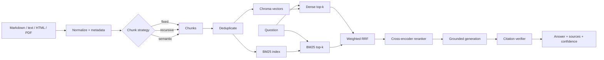

# Hybrid Docs RAG

A production-oriented Retrieval-Augmented Generation system for internal documentation. It ingests Markdown, text, HTML, and PDF files; indexes every chunk in synchronized dense and BM25 stores; fuses results with weighted Reciprocal Rank Fusion; reranks candidates; and returns grounded answers with verified inline citations and explainable confidence scores.

The default stack is free and local: FastEmbed ONNX models, Chroma, BM25, a cross-encoder, and Ollama. If Ollama is unavailable, the API stays useful through a clearly labelled extractive fallback instead of failing or hallucinating. OpenAI-compatible adapters are optional.

## Why this is more than a RAG demo

- Three measured chunking strategies: fixed-overlap, recursive structure-aware, and semantic boundaries.
- Hybrid dense + exact-term retrieval with configurable weights and inspectable per-stage scores.
- Near-duplicate suppression at cosine similarity `>= 0.95`, including duplicates within one ingestion batch.
- Second-stage cross-encoder reranking with a deterministic offline fallback.
- Claim-level citation parsing and verification, plus unsupported-citation flags.
- Structured refusal when retrieval evidence is too weak.
- A 56-question golden evaluation set with lookup, exact-term, multi-hop, ambiguous, and no-answer cases.
- FastAPI/OpenAPI, Streamlit trace dashboard, health checks, Docker Compose, tests, and CI.

## Architecture



The vector store is the indexing source of truth. After every successful ingestion—or rollback after a failure—the BM25 corpus is rebuilt from the vector store under a process lock. This avoids a subtle production failure where dense and sparse results silently represent different document versions.

## Quick start with Docker

Requirements: Docker Desktop with Compose and roughly 6 GB of free disk space for images and local models.

```bash
docker compose up --build -d
docker compose --profile tools run --rm seed
docker compose exec ollama ollama pull llama3.2:3b
```

Open:

- Dashboard: <http://localhost:8501>
- Swagger UI: <http://localhost:8080/docs>
- Health: <http://localhost:8080/health>

The API works before the Ollama model is pulled, but answers use the explicit `extractive` degraded mode. Chroma runs in client/server mode with a persistent named volume, matching its official Docker deployment model.

## Local development

Python 3.11+ and [`uv`](https://docs.astral.sh/uv/) are recommended.

```bash
uv sync --extra dev --extra dashboard
uv run hybrid-rag seed sample_corpus
uv run uvicorn hybrid_rag.api:app --reload --port 8080
uv run streamlit run dashboard/app.py
```

No key is required. Configuration comes from environment variables; the application deliberately does not auto-load secret files. See [`.env.example`](.env.example) for non-secret settings and optional provider names.

## API examples

Ingest a document with an explicit chunking strategy:

```bash
curl -X POST "http://localhost:8080/v1/ingest?strategy=recursive" \
  -F "file=@runbook.pdf"
```

Ask using hybrid retrieval:

```bash
curl -X POST http://localhost:8080/v1/ask \
  -H "Content-Type: application/json" \
  -d '{"question":"What does OBS-1042 mean?","retrieval_mode":"hybrid"}'
```

The response includes the cited answer, verified source quotes, retrieval/fusion/rerank traces, confidence dimensions, provider used, degraded-mode status, and latency.

## Evaluation

Run the golden suite against the current index:

```bash
uv run hybrid-rag evaluate eval_dataset.json --output eval-results/hybrid.json
uv run hybrid-rag evaluate eval_dataset.json --mode dense --output eval-results/dense.json
```

Run a reproducible no-key comparison of all three chunkers:

```bash
uv run python scripts/compare_chunking.py
```

The comparison script creates isolated temporary indexes, ingests the same corpus for every strategy, evaluates both hybrid and dense-only retrieval, and writes JSON plus a Markdown table to `eval-results/`. See [docs/EVALUATION.md](docs/EVALUATION.md) for metric definitions and limitations.

## Configuration highlights

| Variable | Default | Purpose |
|---|---:|---|
| `RAG_CHUNK_STRATEGY` | `recursive` | `fixed`, `recursive`, or `semantic` |
| `RAG_DENSE_WEIGHT` | `0.7` | Dense contribution to weighted RRF |
| `RAG_SPARSE_WEIGHT` | `0.3` | BM25 contribution to weighted RRF |
| `RAG_DUPLICATE_SIMILARITY_THRESHOLD` | `0.95` | Near-duplicate cutoff |
| `RAG_MINIMUM_RETRIEVAL_CONFIDENCE` | `0.25` | Structured “insufficient context” gate |
| `RAG_GENERATION_PROVIDER` | `ollama` | `ollama`, `extractive`, or `openai` |
| `RAG_EMBEDDING_PROVIDER` | `fastembed` | Local ONNX model, hash test provider, optional Sentence Transformers, or OpenAI |
| `RAG_CHROMA_HOST` | empty | Empty uses embedded Chroma; hostname uses server mode |

## Design decisions and trade-offs

- **RRF rather than raw-score blending:** cosine and BM25 scores do not share a stable scale. Rank fusion is robust across corpus changes, while weights still make product priorities tunable.
- **Portable BM25 persistence:** chunks are stored as JSON and the BM25 object is rebuilt. This avoids untrusted pickle loading and makes index state auditable.
- **Provider abstractions, local defaults:** the core pipeline is not coupled to a paid API. OpenAI `text-embedding-3-small` and compatible chat endpoints can be enabled later without changing retrieval code.
- **Conservative citation verification:** local lexical entailment is always available; the configured LLM judges claim/evidence pairs when reachable. A failed judge degrades to the local verifier and never marks failure as proof.
- **Single-node Chroma:** appropriate for a portfolio/internal-doc workload. A larger deployment would add authentication, object storage, distributed workers, and a durable ingestion queue.

More detail is in [docs/ARCHITECTURE.md](docs/ARCHITECTURE.md) and [docs/CASE_STUDY.md](docs/CASE_STUDY.md).

## Quality checks

```bash
uv run ruff check .
uv run ruff format --check .
uv run mypy src
uv run pytest --cov=hybrid_rag --cov-report=term-missing
docker compose config --quiet
```

## Security notes

- Upload type and size are allow-listed; filenames are reduced to a basename before temporary storage.
- Retrieved documents are untrusted evidence, and the generation prompt explicitly rejects instructions inside them.
- Secrets are environment-only, never stored in indexed metadata, logs, or repository files.
- This demo Compose file exposes local ports without auth. Put the API behind identity-aware access control before using real internal documents.

## License

[MIT](LICENSE)
